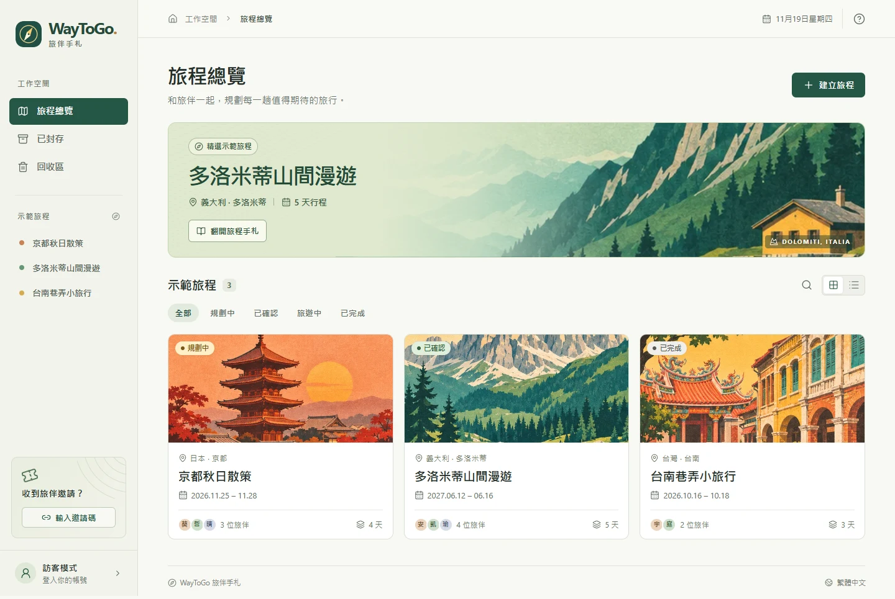

# WayToGo 旅伴手札

供小團體共同規劃旅程的繁體中文 Web / PWA。使用 Google 登入建立旅程，旅伴可用邀請連結、邀請碼或 QR Code 加入。首頁提供三本可直接翻閱的唯讀示範手札。

可共同編排行程、投票、分帳、管理訂位及私人附件，也可將選定旅程儲存到裝置離線閱讀。[需求規格](docs/spec.md) · [第二輪修正與複驗](docs/round2-review.md) · [第一輪 17 項驗收與重跑方式](docs/review-fixes.md) · [8 項資料模型對照](docs/data-model.md)



## 在本機啟動

需要 Docker Engine 與 Docker Compose v2，以及產生初始設定用的 Python 3。於專案根目錄執行：

```sh
python deploy/init_env.py
docker compose up -d --build --wait
```

初始化程式會產生隨機資料庫密碼，只建立新的 `.env`。如未安裝 Python，也可複製 `.env.example` 為 `.env`，自行填入至少 32 個 URL 安全字元的隨機 `POSTGRES_PASSWORD`。Compose 會自動執行 Alembic 遷移並等待資料庫就緒。

開啟 [旅程總覽](http://localhost:3000)、[OpenAPI 文件](http://localhost:3000/docs) 或 [健康檢查](http://localhost:3000/health)。`docker compose logs api web` 可查看啟動問題，`docker compose down` 可停止服務並保留資料。

### 本機測試帳號

在 `PUBLIC_ORIGIN=http://localhost:3000` 的測試環境，可用下列指令產生一組固定帳密。請保存指令顯示的密碼。`.env` 保存密碼雜湊；重啟服務後仍可使用同一個帳號及其旅程。

```sh
python deploy/create_test_login.py
docker compose up -d --build --wait
```

開啟登入視窗後，使用本機測試帳號及產生的密碼登入，即可建立旅程並邀請旅伴。

### Google 登入

在 Google Cloud 建立「網頁應用程式」OAuth 用戶端。將 `http://localhost:3000/api/v1/auth/google/callback` 登記為授權重新導向 URI。在 `.env` 填入 `GOOGLE_CLIENT_ID` 和 `GOOGLE_CLIENT_SECRET`，執行 `docker compose up -d api`。正式環境使用相同 callback 路徑搭配實際 HTTPS 網域。來自同一部署的網站、邀請、Cookie 與 WebSocket 使用同一個 `PUBLIC_ORIGIN`。[Google OIDC 文件](https://developers.google.com/identity/openid-connect/openid-connect)

登入使用授權碼、PKCE、state、nonce 與經驗證的 ID token。伺服器僅保存 Session Token 的雜湊。缺少 OIDC 設定時，登入端點會回傳可辨識的 503 錯誤，展示手札與既有邀請仍可使用。

### 實際體驗多人協作

1. 以 Google 或本機測試帳號登入後按「建立旅程」。只需填寫名稱，也可保留未定日期。
2. 到「旅伴」產生限時邀請。以另一個瀏覽器開啟連結，輸入暱稱加入。
3. 新增候選景點、加入每日行程、拖曳跨日排序，或從移動表單用鍵盤操作。兩個瀏覽器會即時更新。
4. 在「投票」建立景點或日期票選。結束後可查看每人選票、重投或將結果手動加入行程。在「討論」留言或回覆。

管理者也可執行下列指令，建立獨立的台南示範旅程及一組 24 小時有效的訪客邀請。每次執行都建立新資料。可加上 `--owner-id <已登入的 Google 使用者 UUID>` 或 `--hours 2`。省略擁有者時，範例由無登入憑證的展示帳號持有，邀請只授予成員身分。

```sh
docker compose exec api python seed_demo.py
```

## 已實作的需求

| 功能 | 操作與資料規則 |
| --- | --- |
| 身分與成員 | 可在個人帳戶修改顯示暱稱，旅伴頁可查看原始建立者、建立時間及當任擁有者。支援 Google OIDC、訪客 Cookie Session、限時邀請與撤銷、移除、退出、轉移所有權。 |
| 旅程 | 建立、設定、目的地、日期、主要幣別、狀態、封面、封存、刪除與 30 日復原窗口。 |
| 景點與地圖 | 搜尋具座標的維基百科地點或手動輸入，記錄分類、意願、標籤、營業時間、照片網址、預估花費與異動。Leaflet 標記、Google Maps 搜尋與導航。 |
| 每日行程 | Day 1 起的無日期規劃、日期對應、六種項目、跨日排序、時段或停留時間，以及可保留的重疊提醒。移除候選景點會保留已排入的引用。 |
| 協作 | 交易提交後廣播、在線名單、編輯提示、90 秒可續期鎖與版本檢查。重新連線後載入最新資料。原作者與目前編輯者分開記錄。 |
| 共同決策 | 單選、多選、日期與景點投票、補選項與提醒、截止時間、秘密選票、公開結算、歷史輪次、手動採用，以及即時討論串。 |
| 日期協調 | 旅伴可標記單日或區間的「可以、可能、不行」，檢視共同可用區間。擁有者可套用日期，保留既有每日行程。正式投票另支援評分與排序。 |
| 行前清單 | 共用與個人任務可設定期限、關聯附件。每日、每週或每月重複的任務保留各期完成紀錄，多位負責人可分別更新進度。個人清單僅建立者可見。 |
| 預算與分帳 | 支援旅程、個人、類別預算，分開記錄預估和實際支出。可處理多位付款人、部分旅伴分攤、比例或自訂金額，並追蹤部分還款、結清及退出成員的歷史紀錄。 |
| 交通與住宿 | 可輸入多段航班和住宿，關聯每日活動，為各段指定旅客、座位與行李。訂位代號限建立者及該預訂的旅客查看。建立者退出後，擁有者可維護公開預訂資訊。 |
| 地圖、天氣與 PDF | 可匯入可識別的 Google Maps 連結、以直線顯示每日景點順序，並依各地 IANA 時區顯示活動時間。指定日期與詳略後，可透過瀏覽器列印或另存 PDF。 |
| 複製與復原 | 複製候選景點、每日行程和連結的共用安排時會建立新資料。交通與住宿在複本中回到規劃中，清除乘客、訂位代號與原訂單網址。景點與活動可在版本紀錄中單筆復原。 |
| 通知與邀請 | 留言提及旅伴會出現在通知中心，可標記已讀或調整偏好。「用 Email 邀請」會在郵件程式開啟含邀請連結的草稿，由邀請者寄出。 |
| 帳號合併 | 從已登入的訪客身分完成 Google 登入，可合併至既有 Google 帳號。保留旅程、留言、歷史選票與財務紀錄。 |
| 旅程檔案 | 可批次上傳、預覽、下載、授權、回收及還原圖片、PDF 與 Office 文件；旅程、活動、任務、費用及預訂均可關聯附件。旅程複本及兩種行程 PDF 會排除私人文件。 |
| 離線行程 | 在行程頁選擇儲存到本機。斷網後可從新分頁閱讀日期、時間、地點及地址。可手動更新或清除，登出後會清除這個帳號的本機行程。 |

## 架構與設定

`瀏覽器 → nginx → Next.js / FastAPI → PostgreSQL`

- `frontend/` 包含 Next.js、React、TypeScript、Tailwind、Radix/shadcn 風格元件與 Leaflet。
- `backend/app/` 是模組化單體。REST API 位於 `/api/v1`，即時端點為 `/ws/trips/{id}`。後端負責授權、版本、編輯鎖與交易。單一 Uvicorn worker 管理在線連線。
- `backend/migrations/` 保存可重現的 Alembic 遷移。物件與成員關聯使用外鍵、唯一限制及索引。
- `deploy/` 包含部署初始化、反向代理及備份程式。主機只公開 nginx，資料庫與 API 留在 Compose 內部網路。

附件內容、授權、關聯及回收狀態一起存放於 PostgreSQL，納入同一份備份。單檔上限預設為 10 MiB，每旅程配額為 500 MiB，可分別用 `FILE_MAX_BYTES`、`TRIP_FILE_QUOTA_BYTES` 調整。邀請重送使用穩定的 `INVITATION_SIGNING_KEY`。若自行設定，請將其隨部署私密設定另外備份。

地點搜尋僅在使用者送出時連線，包含快取、限速及逾時。可用 `WIKI_API_URL` 更換相容的 MediaWiki 服務，或留空停用。地圖圖磚由瀏覽器依目前視窗取得，顯示 OSM 出處。可在建置前端時用 `NEXT_PUBLIC_TILE_URL` 指定相容且符合授權的 OSM 圖磚來源。可持續讀取資料庫中的地址與行程。[OSM 圖磚政策](https://operations.osmfoundation.org/policies/tiles/)

天氣來自 Open-Meteo，須有日期和地點座標，且在預報期間內。可設 `OPEN_METEO_URL` 指向相容服務或留空停用。多幣別分帳可取得 Frankfurter 的參考匯率，供應商無資料時可自行填入。記帳時保存匯率與換算金額。可用 `FRANKFURTER_URL` 指定相容服務的 v2 網址或留空停用查詢。

### 選用瀏覽器推播

在 `.env` 設定 `VAPID_SUBJECT` 為站台維護者的 `mailto:` 聯絡信箱，並設定固定的 `VAPID_PRIVATE_KEY`。可在已安裝後端套件的環境產生一組私鑰，保存到該部署的私有設定。

```sh
python -c "import base64; from cryptography.hazmat.primitives.asymmetric import ec; print(base64.urlsafe_b64encode(ec.generate_private_key(ec.SECP256R1()).private_numbers().private_value.to_bytes(32, 'big')).rstrip(b'=').decode())"
docker compose up -d api
```

在 HTTPS 或 localhost 使用支援推播的瀏覽器，於通知中心點「啟用這台裝置的推播」並允許通知。鎖定畫面顯示一般提及提醒，開啟通知中心後依目前帳號權限讀取內容。站內通知可獨立使用。

## 部署與備份

公開部署時，將 `PUBLIC_ORIGIN` 設定為實際 HTTPS 網址，由前置反向代理終止 TLS，並允許 WebSocket Upgrade。預設僅綁定 `127.0.0.1:3000`。調整埠號時一併調整 `HTTP_PORT`、`PUBLIC_ORIGIN` 與 OAuth callback。伺服器在 HTTPS 部署下設定 Secure、HttpOnly、SameSite=Lax Cookie。

PostgreSQL 使用持久化 Volume。備份服務啟動時及每隔 24 小時產生自訂格式的 `pg_dump`，成功後才清理超過七日的舊備份。備份失敗或剩餘容量低於 512 MiB 時會寫入容器日誌。將 `BACKUP_DIR` 指向另一個裝置或掛載位置，並定期在新的資料庫驗證還原。預設的同機備份無法涵蓋整台主機遺失的情況。

獨立的 `restore-drill` 服務每小時尋找新的每日備份，還原至全新的 PostgreSQL，檢查遷移版本、約束、核心資料筆數及附件大小。它以唯讀模式掛載備份，並使用容器內的 Unix socket。還原資料與暫存日誌在每次驗證後清除。可用下列指令檢視結果，或立即驗證保留中的每份每日備份。

```sh
docker compose logs restore-drill
docker compose run --rm --no-deps restore-drill --all
```

## 開發與驗證

使用 Python 3.12、Node.js 24 與專案指定的 pnpm 版本。非容器開發可分別執行以下指令。後端請先設定 `DATABASE_URL` 與 `PUBLIC_ORIGIN=http://localhost:3000`。開發及測試可用 `sqlite:///./dev.db`，部署使用 PostgreSQL。

```sh
cd backend
python -m pip install -r requirements-dev.txt
alembic upgrade head
uvicorn app.main:app --host 127.0.0.1 --port 8000 --no-access-log
```

```sh
cd frontend
pnpm install --frozen-lockfile
pnpm dev
```

開發伺服器預設將 API 與 WebSocket 轉送到本機 8000 埠，可用 `API_UPSTREAM` 調整。請使用與 `PUBLIC_ORIGIN` 一致的網址開啟前端。

| 測試 | 指令 |
| --- | --- |
| 後端授權、遷移、協作 | 在 backend 執行 `python -m pytest -q`、`alembic check` 及 `ruff check .`。可設定 `TEST_DATABASE_URL` 指向專用 PostgreSQL 測試資料庫，每個案例有獨立 schema。 |
| 前端 | 在 frontend 執行 `pnpm typecheck`、`pnpm lint`、`pnpm format:check`、`pnpm test` 與 `pnpm build`。 |
| 瀏覽器 | 在專用測試站執行 `pnpm exec playwright install chromium` 與 `pnpm e2e`。以 `E2E_DISPOSABLE=1` 及該站測試帳密啟用寫入流程，`E2E_INVITE` 啟用示範旅程的雙瀏覽器協作測試。隔離測試工具與用法見[本版驗收紀錄](docs/review-fixes.md)。 |
| 自動化 | GitHub Actions 對 push 與 PR 執行 PostgreSQL 測試、Docker Compose 建置、瀏覽器驗收與資料庫還原演練。 |

協作開發以功能分支提交 PR，通過 CI 並由另一位成員審查後再合併。前端只向授權 API 讀寫資料，對外提供的 OpenAPI JSON 可在 `/openapi.json` 取得。


在專案根目錄執行 `python backend/run_live_acceptance.py` 可用隔離資料庫重跑真實登入與雙瀏覽器協作測試。已安裝 Chrome 的電腦可透過 `CHROME_EXECUTABLE` 指定瀏覽器執行檔。測試工具會建立暫時的本機帳號與旅程。

## P1 本機驗收紀錄

- 47 項後端測試在 PostgreSQL 和 SQLite 均通過。測試涵蓋拆帳尾差、重複提交、成員退出、帳號合併、訂位權限、已讀狀態及推播失敗。
- 雙瀏覽器驗收使用獨立帳號及資料庫，實際登入、邀請、核對個人清單與旅客可見欄位，並將一筆外幣費用分兩次結清。日期協調、排序與評分投票，以及指定日期的 PDF 檔也已用 Chromium 驗證。
- PostgreSQL 驗證涵蓋既有資料升至遷移版本 0007、降版及重新升版。推播協定與失效訂閱使用模擬供應商測試，實機接收需要部署者的 VAPID 設定和使用者授權。

## P0 本機驗收紀錄

- 17 個後端測試分別在 PostgreSQL 及 SQLite 通過，涵蓋邀請過期、訪客限制、所有權轉移、編輯租約、舊版本拒絕、秘密選票、投票輪次，以及五個 WebSocket 客戶端的同步與撤權。
- 前端正式建置、型別、Lint、格式和 3 個 Vitest 測試通過。Playwright 以桌面及手機尺寸實際檢查，包含兩個獨立瀏覽器身分交換留言、建立活動及跨日移動。
- 本機五位成員的 60 次讀取 P95 為 64 ms。12 次留言提交廣播給五個客戶端，從發出寫入到重新取得資料的 60 個觀測值 P95 為 73 ms。環境為同機 PostgreSQL、HTTP 與 WebSocket，時間不含畫面繪製。
- Alembic 遷移與模型一致，實際資料可透過 `pg_dump` 還原到新的資料庫。Docker Compose v2.39.4 已驗證設定語法。本機已於 Docker Compose 部署並驗證固定測試帳號登入。Google OIDC 的自動化測試使用模擬的 Google 回應，真實帳號登入須使用部署者的憑證。

展示封面使用內建 ImageGen 製作。圖像提示指定復古絹印旅遊海報風格，以山谷小徑、京都古塔、多洛米蒂湖畔和台南街景組成四格畫稿。網站使用的四張 WebP 存於 [frontend/public/art](frontend/public/art/)。
